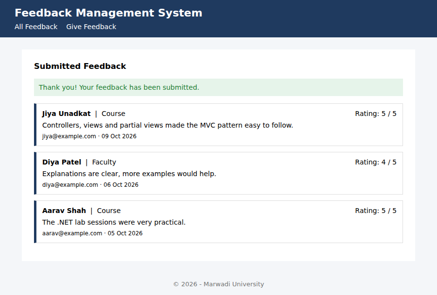
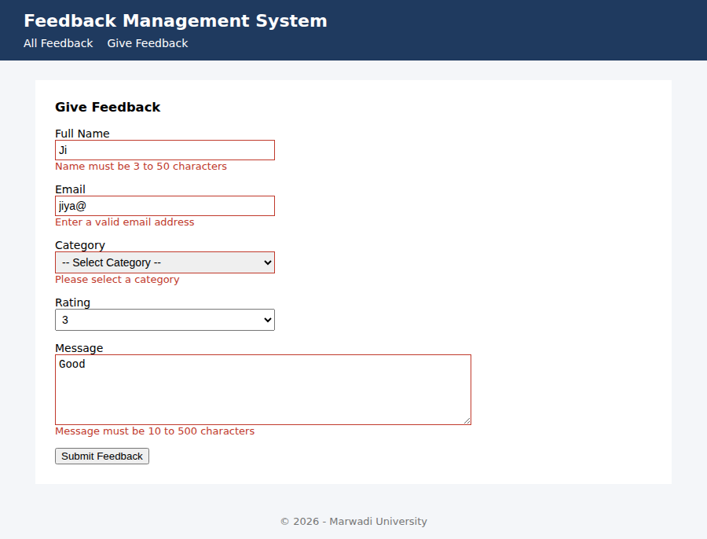

# Practical 7 - Feedback Management Module (ASP.NET MVC)

**Course:** 01CE1523 - .NET Technologies
**Aim:** Develop Feedback Management Module using MVC Layout, Partial View & Validation (HTML Helpers, Validation, Layouts)

**Author:** Jiya Unadkat (92400103410)

## Features
- Shared layout (`_Layout.cshtml`) with navigation and footer
- Partial view (`_FeedbackCard.cshtml`) used to render each feedback entry
- HTML helpers: `BeginForm`, `LabelFor`, `TextBoxFor`, `DropDownListFor`, `TextAreaFor`, `ValidationMessageFor`, `AntiForgeryToken`
- Server-side and client-side validation with Data Annotations
- In-memory data store (no database required)

## Project structure
```
FeedbackManagement/
  App_Start/RouteConfig.cs
  Controllers/FeedbackController.cs
  Models/Feedback.cs
  Views/_ViewStart.cshtml
  Views/Shared/_Layout.cshtml
  Views/Shared/_FeedbackCard.cshtml
  Views/Feedback/Index.cshtml
  Views/Feedback/Create.cshtml
```

## How to run
1. Open `FeedbackManagement.sln` in Visual Studio 2019/2022 (with the ASP.NET workload).
2. Right-click the solution -> **Restore NuGet Packages**.
3. Press **F5**. The app opens on the Feedback list; use **Give Feedback** to test validation.

## Output


